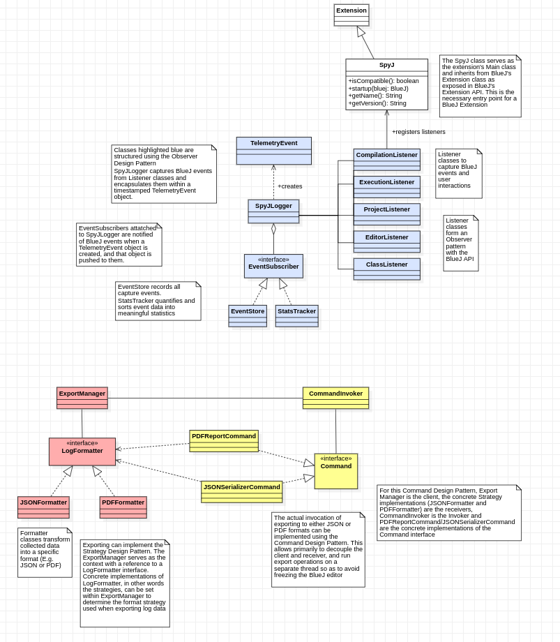
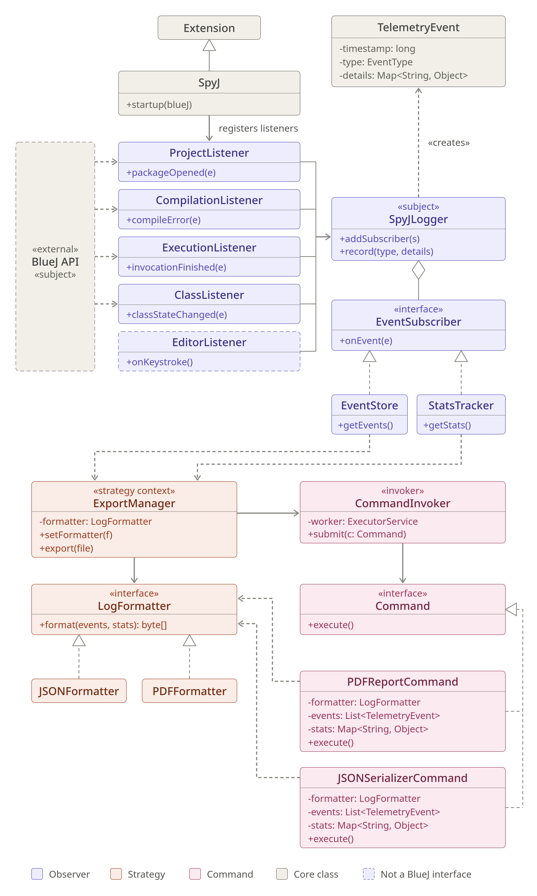

# SpyJ

A data analytics plugin for collecting, formatting and analysing telemetry data produced using the BlueJ coding editor.

---

## Table of Contents

- [Overview](#overview)
- [Architecture](#architecture)
- [Entry Point — `SpyJ`](#entry-point--spyj)
- [Logger Package](#logger-package)
  - [SpyJLogger](#spyjlogger)
  - [EventSubscriber](#eventsubscriber)
  - [TelemetryEvent](#telemetryevent)
  - [EventType](#eventtype)
  - [DetailsKey](#detailskey)
  - [EventStore](#eventstore)
  - [StatsTracker](#statstracker)
- [Listener Package](#listener-package)
  - [ProjectListener](#projectlistener)
  - [ClassListener](#classlistener)
  - [CompilationListener](#compilationlistener)
  - [ExecutionListener](#executionlistener)
  - [EditorListener](#editorlistener)

---

## Overview

SpyJ is a [BlueJ](https://www.bluej.org/) Extension (Extensions API v2) that observes a student's coding session and collects structured telemetry data. When BlueJ shuts down, SpyJ exports a session report (JSON + PDF) that should describe how the student worked: what projects and classes were touched, how much they typed, how often they compiled, and what errors they encountered.

The plugin follows a **publish-subscribe** design:

1. **Listeners** (one per BlueJ event type) translate raw BlueJ callbacks into typed `TelemetryEvent` objects and hand them to `SpyJLogger`.
2. **SpyJLogger** pushes each event out to all registered **subscribers**.
3. Two subscribers run in parallel — `EventStore` (append-only event log) and `StatsTracker` (live aggregated statistics).
4. On shutdown, `ReportExporter` reads both subscribers and writes the final report.

---

## Architecture






---

## Entry Point — `SpyJ`

**File:** `src/main/java/com/spyj/SpyJ.java`

`SpyJ` extends `bluej.extensions2.Extension` and serves as the plugin's lifecycle manager. BlueJ instantiates it automatically when the extension is loaded.

### Lifecycle Methods

| Method | Description |
|--------|-------------|
| `startup(BlueJ bluej)` | Called by BlueJ when the extension is loaded. Initialises all core components (`SpyJLogger`, `EventStore`, `StatsTracker`, `ReportExporter`) and all five listeners, then registers each listener with the BlueJ API. Records the session start time. |
| `terminate()` | Called by BlueJ on shutdown. Flushes any in-progress editor burst via `EditorListener.stop()`, then calls `ReportExporter.export(...)` if there are events to report. Guards against double-export with the `reportGenerated` flag. |
| `isCompatible()` | Returns `true` when the BlueJ Extensions API major version is ≥ 3. |
| `getVersion()` | Returns the plugin version string (`"1.0.0"`). |
| `getName()` | Returns `"SpyJ"`. |
| `getDescription()` | Returns a human-readable description of the plugin. |

### Fields

| Field | Type | Purpose |
|-------|------|---------|
| `sJLogger` | `SpyJLogger` | Central event logger; shared by all listeners. |
| `eventStore` | `EventStore` | Subscriber that persists every raw event for the report. |
| `statsTracker` | `StatsTracker` | Subscriber that maintains live aggregated statistics. |
| `reportExporter` | `ReportExporter` | Writes the final JSON/PDF report on session end. |
| `sessionStart` | `Instant` | The timestamp captured at plugin startup, used to name the session and to measure total session duration. |
| `reportGenerated` | `boolean` | Prevents `terminate()` from attempting a second export if called more than once. |

### Listener Registration

```
// For Class Events
bluej.addClassListener(classListener) 

// For Project Events               
bluej.addPackageListener(projectListener)    

// For Compile Events
bluej.addCompileListener(compilationListener) 

// For Execution Events
bluej.addInvocationFinishedListener(executionListener)
                                                          
// Note: EditorListener self-registers onto JavaFX window events.
// Therefore, it does not register with the BlueJ API.
// Also, there is no exposed BlueJ API for EditorEvent capture...
```

---

## Logger Package

**Package:** `com.spyj.logger`

The logger package is the core of SpyJ's data model. It receives captured BlueJ event data and processes them into TelemetryEvent objects, which encapsulates the captured event data with a timestamp of when said TelemetryEvent objects were created. SpyJLogger is the core of the logger package, and serves as the Subject to which EventSubscribers are attatched to. Created TelemetryEvent objects within SpyJLogger are pushed to EventSubscribers for persistence throughout the Editor's currently running process and for the quantifying of event data into useful statistics.

---

### SpyJLogger

**File:** `src/main/java/com/spyj/logger/SpyJLogger.java`

The central logger bus. All five listeners hold a reference to the same `SpyJLogger` instance and call `recordEvent(...)` to publish captured event data to SypJLogger, that 'updates' its internal state, causing attatched subscribers to be notified (i.e. the relevant recorded event's data is pushed to them).

#### Responsibilities
- Maintains a list of `EventSubscriber` instances.
- Wraps raw event data into a timestamped `TelemetryEvent` object and pushes it to every subscriber.
- Attempts to gracefully handle individual subscriber exceptions so that one failing subscriber cannot break the others and by extension the running BlueJ proccess.

#### Key Methods

| Method | Description |
|--------|-------------|
| `addSubscribers(EventSubscriber)` | Registers a new subscriber. Called during `SpyJ.startup()` to add `EventStore` and `StatsTracker`. |
| `recordEvent(EventType, Map<String, Object>)` | Constructs a `TelemetryEvent` with the current timestamp and pushes it to all subscribers. Each attempt to push a `TelemetryEvent` object is wrapped in a try/catch; with failures being printed to stdout. The setup of BlueJ means anything printed to stdout actually goes to a log file instead as that datastream is redirected. |

---

### EventSubscriber

**File:** `src/main/java/com/spyj/logger/EventSubscriber.java`

The subscriber interface that any event subscriber must implement.

```java
public interface EventSubscriber {
    void onEvent(TelemetryEvent e);
}
```

Both `EventStore` and `StatsTracker` implement this interface. This design makes it trivial to add new subscribers without changing any existing code, and is inline with the Observer Pattern.

---

### TelemetryEvent

**File:** `src/main/java/com/spyj/logger/TelemetryEvent.java`

An record of a single captured BlueJ event whose raw data has been extracted and encapsulated within this timestamped object. Created by `SpyJLogger.recordEvent(...)` and pushed to every subscriber.

#### Fields

| Field | Type | Description |
|-------|------|-------------|
| `timestamp` | `Instant` | The UTC instant at which the event was recorded. Auto-set to `Instant.now()` by the primary constructor, or supplied explicitly by the secondary constructor. |
| `eventType` | `EventType` | Enum classifying the category a captured event falls into. |
| `eventDetails` | `Map<String, Object>` | The extracted metadata from a captured event. Keys are standardised via `DetailsKey`. |

#### Constructors

| Constructor | Description |
|-------------|-------------|
| `TelemetryEvent(EventType, Map)` | Standard constructor — timestamp is set to `Instant.now()`. |
| `TelemetryEvent(EventType, Map, Instant)` | Explicit timestamp — can be used when a custom time is needed or as a redundant form of the implicit assignment done within the constructor. |

---

### EventType

**File:** `src/main/java/com/spyj/logger/EventType.java`

An enum that enumerates every kind of event SpyJ can record. The enum values are grouped by domain:

| Group | Values | Notes |
|-------|--------|-------|
| **Project lifecycle** | `PROJECT_CREATED`, `PROJECT_DELETED`, `PROJECT_OPENED`, `PROJECT_CLOSED`, `PROJECT_MODIFIED` | __ |
| **Class lifecycle** | `CLASS_CREATED`, `CLASS_DELETED`, `CLASS_OPENED`, `CLASS_CLOSED`, `CLASS_MODIFIED` | `CLASS_CREATED` / `CLASS_DELETED` are also project modifications |
| **Method** | `METHOD_DEFINED` | Recorded when a new method signature is detected |
| **Editor** | `EDITOR_IDLE`, `EDITOR_BURST` | Keystroke timing determines whether the user is in an active typing burst or idle |
| **Compilation** | `COMPILE_SUCCEEDED`, `COMPILE_FAILED`, `COMPILE_WARNING`, `COMPILE_ERROR` | Error events include line number and error message |
| **Execution** | `EXECUTION_SUCCEEDED`, `EXECUTION_EXCEPTION` | Exception events that should include console output (console outputs are not handled within the extension) |

---

### DetailsKey

**File:** `src/main/java/com/spyj/logger/DetailsKey.java`

An enum of standardised keys used in `TelemetryEvent.eventDetails` maps. Using an enum rather than raw strings prevents typos and makes it easy to find every location where a particular detail is written or read.

| Constant | Label string | Used by |
|----------|-------------|---------|
| `PROJECT_NAME` | `"Project"` | `ProjectListener`, `StatsTracker` |
| `CLASS_NAME` | `"Class"` | `ClassListener`, `ExecutionListener`, `StatsTracker` |
| `CLASS_OLD_NAME` | `"Class Old Name"` | `ClassListener`, `StatsTracker` |
| `METHOD_NAME` | `"Method"` | `ExecutionListener`, `StatsTracker` |
| `EXIT_STATUS` | `"Exit Status"` | `ExecutionListener`, `StatsTracker` |
| `USER_GENERATED` | `"User Generated"` | `CompilationListener`, `StatsTracker` |
| `COMPILE_DURATION` | `"Compile Duration"` | `CompilationListener`, `StatsTracker` |
| `ERROR_MESSAGE` | `"Error Message"` | `CompilationListener`, `StatsTracker` |
| `ERROR_LINE` | `"Error Start Line"` | `CompilationListener`, `StatsTracker` |
| `KEYSTROKE_COUNT` | `"Keystroke Count"` | `EditorListener`, `StatsTracker` |
| `BURST_DURATION` | `"Burst Duration"` | `EditorListener`, `StatsTracker` |
| `CADENCE_KPM` | `"Cadence KPM"` | `EditorListener`, `StatsTracker` |
| `SESSION_KEYSTROKES` | `"Total Session Keystrokes"` | `EditorListener`, `StatsTracker` |
| `IDLE_DURATION` | `"Idle Duration Time"` | `EditorListener`, `StatsTracker` |

---

### EventStore

**File:** `src/main/java/com/spyj/logger/EventStore.java`

An `EventSubscriber` that ideally should act as an append-only, thread-safe log of every `TelemetryEvent` received during a session. It is the primary data source for the report exporter.

#### Key Methods

| Method | Description |
|--------|-------------|
| `onEvent(TelemetryEvent)` | Appends a non-null event to the internal list. |
| `getEvents()` | Returns an unmodifiable snapshot of all events. |
| `getEvents(EventType)` | Returns an unmodifiable list of events matching the given type. |
| `size()` | Returns the total number of stored events. |
| `clear()` | Clears all stored events. |

All public methods are `synchronized` to allow safe access from both the BlueJ event thread and the JavaFX Application Thread (used by `EditorListener`).

---

### StatsTracker

**File:** `src/main/java/com/spyj/logger/StatsTracker.java`

An `EventSubscriber` that maintains a continuously-updated set of aggregated statistics. `StatsTracker` updates its counters incrementally as each event arrives, ensuring an up-to-date set of telemetry metrics are maintained throughout the user's session.

#### Statistics Categories

`getStats()` returns a `Map<String, Object>` with the following top-level keys, each mapping to a nested stats map:

| Category | Key statistics |
|----------|---------------|
| **Session** | Total events, first/last event timestamps, session duration (ms) |
| **Project Lifecycle** | Counts of created/opened/closed/modified/deleted projects; distinct projects opened |
| **Class Lifecycle** | Counts of created/modified/renamed/deleted classes; distinct classes touched; most-modified class |
| **Editor Interactions** | Total keystrokes; KPM (session-wide and per burst); burst count/duration/length; peak cadence; idle count/duration/longest idle |
| **Compilation** | Total succeeded/failed compiles; success rate; user-initiated compiles; errors & warnings; average errors per failed compile; average compile duration; recovery metrics; top 3 error messages; most frequent error line |
| **Execution** | Total succeeded/exception runs; exception rate; exit status breakdown; distinct methods run; most-run method |
| **Event Counts** | Counter of the number of events per `EventType` that occured |

#### Internal Event Handlers (private)

| Handler | Triggered by |
|---------|-------------|
| `onProjectOpened` | `PROJECT_OPENED` — adds project name to the distinct-projects set |
| `onClassEvent` | `CLASS_CREATED`, `CLASS_DELETED`, `CLASS_MODIFIED` — tracks renames, touched-class set, and per-class modification counts |
| `onEditorBurst` | `EDITOR_BURST` — accumulates keystroke/duration/cadence statistics |
| `onEditorIdle` | `EDITOR_IDLE` — accumulates idle time and longest-idle record |
| `onCompileFinished` | `COMPILE_SUCCEEDED`, `COMPILE_FAILED` — tracks duration, user-initiated flag, and failure-recovery timing |
| `onCompileError` | `COMPILE_ERROR` — counts error message frequencies (first line only) and error line frequencies |
| `onExecution` | `EXECUTION_SUCCEEDED`, `EXECUTION_EXCEPTION` — counts exit statuses and per-method run counts |

---

## Listener Package

**Package:** `com.spyj.listener`

Each listener connects a specific BlueJ (or JavaFX for EditorListener) API to the `SpyJLogger`. Listeners translate BlueJ events into a curated set of `Map<String, Object>` detail stores and call `sjLogger.recordEvent(...)`. The Listener classes themselves form a psudeo Observer Pattern with BlueJ's API.

---

### ProjectListener

**File:** `src/main/java/com/spyj/listener/ProjectListener.java`

Implements `bluej.extensions2.event.PackageListener`. BlueJ fires package events whenever the user opens or closes a project (a BlueJ "project" is exposed through its root package).

#### Events Recorded

| BlueJ Callback | Event Recorded | Details |
|----------------|---------------|---------|
| `packageOpened` | `PROJECT_OPENED` | Project name, directory, project structure string, opened package name. Only the **first** package-open event per project directory fires a `PROJECT_OPENED` event (subsequent package opens within the same project are ignored). |
| `packageClosing` | `PROJECT_CLOSED` | Project name, directory. The event is deferred onto the JavaFX Application Thread via `Platform.runLater(...)` so that `bluej.getOpenProjects()` reflects the closed state before the event is recorded. |

#### Class Pre-population

On `packageOpened`, `ProjectListener` calls `classListener.addExistingClasses(currPackage)` to seed `ClassListener`'s internal file set with classes that already existed when the project was opened. This prevents pre-existing classes from being reported as newly created.

---

### ClassListener

**File:** `src/main/java/com/spyj/listener/ClassListener.java`

Implements `bluej.extensions2.event.ClassListener`. BlueJ fires class events whenever a class is added, removed, or renamed.

#### Events Recorded

| BlueJ Callback | Event Recorded | Details |
|----------------|---------------|---------|
| `classStateChanged` | `CLASS_CREATED` (first time a class file is seen) or `CLASS_MODIFIED` (subsequent state changes) | Class name, package name, compilation status. Distinguishes creation from modification by tracking seen class files in a `HashSet<File>`. |
| `classRemoved` | `CLASS_DELETED` | Class name, package name. Removes the file from the internal tracking set. |
| `classNameChanged` | `CLASS_MODIFIED` | New class name, old class name (`"Class Old Name"`), package name, compilation status. Updates the internal tracking set by swapping the old file path for the new one. |

#### `addExistingClasses(BPackage)`

Called by `ProjectListener` on project open to pre-populate the internal `HashSet<File>` with files that already exist. Without this, all pre-existing classes would be incorrectly reported as `CLASS_CREATED` on first observation.

---

### CompilationListener

**File:** `src/main/java/com/spyj/listener/CompilationListener.java`

Implements `bluej.extensions2.event.CompileListener`. Tracks the full lifecycle of a compilation pass.

#### Events Recorded

| BlueJ Callback | Event Recorded | Details |
|----------------|---------------|---------|
| `compileStarted` | *(none)* | Records `startTime = Instant.now()` for duration tracking. |
| `compileSucceeded` | `COMPILE_SUCCEEDED` | Compile status, duration (ms), whether user-initiated, list of compiled file names. |
| `compileFailed` | `COMPILE_FAILED` | Same payload as `COMPILE_SUCCEEDED` but with status `"Failed"`. |
| `compileWarning` | `COMPILE_WARNING` | Warning line number, message text, character position. |
| `compileError` | `COMPILE_ERROR` | Error line number, message text, character position. |

The duration is computed as the elapsed time from `compileStarted` to the finish callback. `startTime` is set to `null` after recording to guard against stale measurements.

---

### ExecutionListener

**File:** `src/main/java/com/spyj/listener/ExecutionListener.java`

Implements `bluej.extensions2.event.InvocationFinishedListener`. Fires whenever the user invokes a method or constructor from the BlueJ object bench or object inspector.

#### Events Recorded

| BlueJ Exit Condition | Event Recorded | Details |
|----------------------|---------------|---------|
| `NORMAL_EXIT` | `EXECUTION_SUCCEEDED` | Package, class, method, parameters list, target object (or `"Static Instance"`), exit status. |
| Any other exit | `EXECUTION_EXCEPTION` | Same payload. |

---

### EditorListener

**File:** `src/main/java/com/spyj/listener/EditorListener.java`

Monitors all JavaFX keyboard events across every BlueJ editor window. Because BlueJ does not expose an editor-level keystroke API, `EditorListener` hooks into the JavaFX window system directly.

#### Design

- **Window discovery** — On construction, iterates `Window.getWindows()` to hook all currently-open stages, then installs a `ListChangeListener` to hook any stage opened later.
- **Editor detection** — `isEditorStage(Stage)` identifies editor windows by title format: not starting with `"BlueJ:"` and containing `"["` with a trailing `"]"`.
- **Typing key filter** — `isTypingKey(KeyEvent)` returns `true` for printable characters, Backspace, Delete, Enter, Tab, and paste/cut/undo/redo shortcuts (Ctrl+V/X/Z/Y). Navigation, modifier, and function keys are excluded.
- **Burst model** — Consecutive keystrokes in the same editor window form a *burst*. A burst ends when the user is idle for more than `IDLE_THRESHOLD_MS` (3 000 ms), or when focus moves to a different editor stage. A burst is only recorded if it contains at least `MIN_BURST_KEYSTROKES` (2) keystrokes and has a non-zero duration.
- **Idle timer** — A JavaFX `PauseTransition` of 3 000 ms is restarted on every keystroke. When it fires, `onUserBecameIdle()` flushes the active burst and marks the state as idle.

#### Events Recorded

| Condition | Event Recorded | Details |
|-----------|---------------|---------|
| Idle timer fires (user stops typing for ≥ 3 s) | `EDITOR_IDLE` (on next keystroke or `stop()`) | Editor title where idle started, title of window where typing resumed, idle duration (ms), running session idle total (ms). |
| Burst ends (stage change or idle timer) | `EDITOR_BURST` | Editor title, keystroke count, burst duration (ms), cadence (KPM), average inter-keystroke time (ms), running session total keystrokes. |

#### `stop()`

Called by `SpyJ.terminate()` before reading the event store. Runs on the JavaFX Application Thread (or schedules via `Platform.runLater` with a 2-second `CountDownLatch` if called off-thread) to ensure the final in-progress burst and any pending idle event are flushed before the report is generated.
